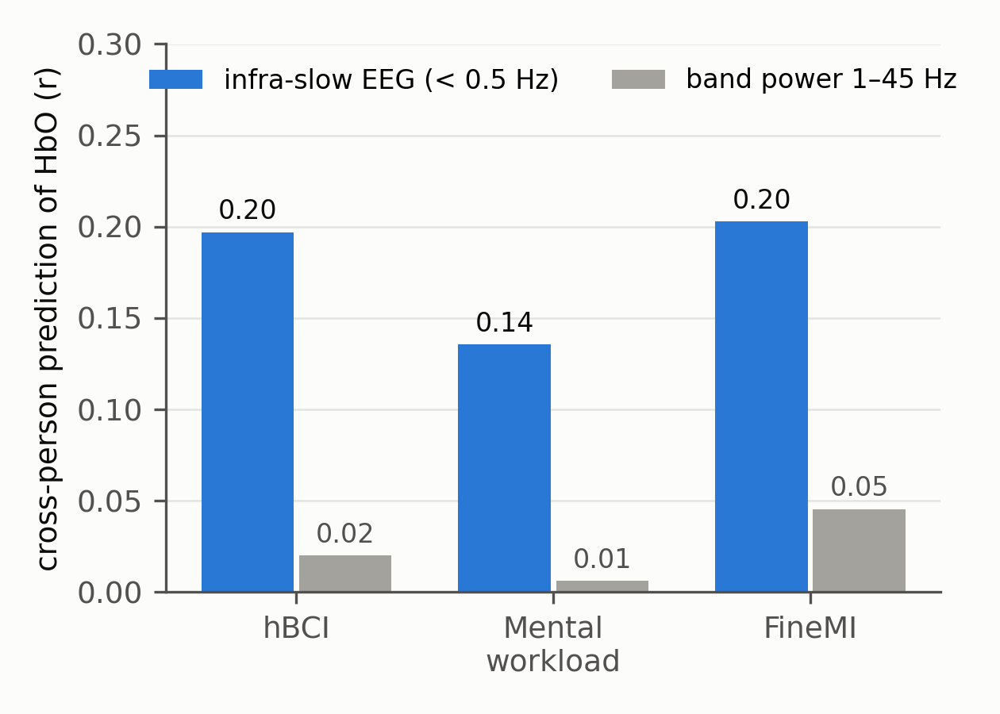

# NeuroVascNet

**Cross-modal prediction of fNIRS and fMRI haemodynamics from infra-slow scalp EEG**


This repository contains the analysis code, the dated analysis plan, the multiplicity ledger and all result files
for the study

> **Rafsan Jany, Muntasir Hossain, Maisha Rahman.**
> *Cross-Modal Prediction of fNIRS Haemodynamics From Infra-Slow EEG: Ridge Regression, Shared Low-Rank Space
> and Two-Run Calibration.* Manuscript under review.

---

## Contents

1. [Abstract](#abstract)
2. [Key results](#key-results)
3. [Methods in brief](#methods-in-brief)
4. [Datasets](#datasets)
5. [Repository structure](#repository-structure)
6. [Installation](#installation)
7. [Reproducing the results](#reproducing-the-results)
8. [Mapping from the manuscript to the code](#mapping-from-the-manuscript-to-the-code)
9. [Analysis plan and multiplicity](#analysis-plan-and-multiplicity)
10. [Limitations](#limitations)
11. [Citation](#citation)
12. [Authors and acknowledgements](#authors-and-acknowledgements)

---

## Abstract

Estimating haemodynamic signals from scalp electroencephalography (EEG) would allow low-cost monitoring, but
cross-person prediction is close to chance after conventional filtering. We tested whether the band removed by
that filtering carries the missing information. Simultaneous EEG and functional near-infrared spectroscopy
(fNIRS) from 88 people in four cohorts from three laboratories, and EEG with functional magnetic resonance imaging
(fMRI) from 27 people, were analysed with ridge regression on EEG below 0.5 Hz and compared with band-power models
under leave-one-person-out, leave-one-run-out and frozen-transfer validation. Pass rules were fixed before each
test, and Bonferroni correction covered every attempt.

Infra-slow EEG predicted oxyhaemoglobin (HbO) across people at *r* = 0.135–0.203 in three cohorts, against
0.006–0.045 for band power, and a standard 0.5–45 Hz band-pass reduced the prediction of a deep network from
*r* = 0.158 to 0.019. One shared EEG space predicted fNIRS and fMRI in unseen people without loss for either output.
After two calibration runs, EEG-only models exceeded each person's mean response, and the calibration score
predicted later accuracy. Models frozen in one laboratory did not transfer to another, and the advantage was not
established in a third laboratory.

---

## Key results

<p align="center">
  
</p>
<p align="center"><em>Cross-person prediction of HbO (ridge, leave-one-person-out): infra-slow EEG against band power.</em></p>

| Finding | Evidence | Status |
|---|---|---|
| **The information lies in the infra-slow band** | Infra-slow EEG *r* = 0.135–0.203 vs band power 0.006–0.045 (hBCI, MW, FineMI); held on 30 s windows not aligned to cues | Supported in 3 cohorts, 2 laboratories |
| **Conventional filtering removes it** | Deep network in hBCI: *r* = 0.158 unfiltered vs 0.019 after 0.5–45 Hz band-pass; 98% of the score lies below 0.5 Hz | Supported (hBCI) |
| **One EEG space serves fNIRS and fMRI** | Rank-32 shared space: fNIRS *r* = 0.123 (MW), 0.180 (FineMI); fMRI *r* = 0.063–0.068, *p* = 0.0001; 90% CI lower bounds −0.014 and −0.003 above the −0.02 margin | Supported (non-inferiority) |
| **Two-run calibration enables EEG-only monitoring** | Gain over each person's mean response +0.059 to +0.176; calibration score vs later accuracy Spearman ρ = 0.56–0.90 | Supported in 3 cohorts |
| **Band power leads local HbO** | Median delay +6 s in hBCI, 29 of 29 people above their surrogates (Wilcoxon *p* < 0.0001); kernel shape repeats within person | Supported; precise delay repeats only in hBCI |
| **Transfer between laboratories** | Within-laboratory transfer +0.177 to +0.217; every cross-laboratory harmonisation failed | Not supported across laboratories |
| **Third laboratory** | Only band-power coupling passed (1 of 6 pre-declared tests) | Not established |
| **fMRI supervision improves fNIRS** | No gain over shuffled fMRI targets in any cohort | Not supported |

Values are means over people with 95% bootstrap confidence intervals in the manuscript; *r* is the per-person
window correlation after removing each person's task mean (Section 2.4 of the manuscript).

---

## Methods in brief

| Component | Description |
|---|---|
| **Features** | EEG resampled to 200 Hz, z-scored per 30 s window, low-passed at 0.5 Hz (4th-order Butterworth, zero phase) and averaged into 30 bins of 1 s per channel. Comparator: log band power, 1–45 Hz. |
| **Targets** | HbO and HbR from the modified Beer–Lambert law, band-passed at 0.01–0.2 Hz, baseline-corrected; global (channel mean) and local (channel minus mean) targets. BOLD from five motor regions of interest. |
| **Ridge regression** | Closed form, one λ for all outputs chosen by efficient leave-one-out over 13 values from 10⁰ to 10⁶. |
| **Shared low-rank space** | SVD of the normalised fNIRS and fMRI ridge maps; first *K* = 32 columns as a shared EEG basis, with a ridge head per modality. |
| **Personal calibration** | Calibration mean response plus a personal ridge model of the residual, fitted on two runs; a hybrid with a population model gives the reliability score. |
| **Lagged coupling** | Band power to local HbO at lags −10 to +20 s, leave-one-run-out, circular-shift surrogates, split-half kernel reproducibility. |
| **Deep comparator** | Three-layer convolutional encoder (11.9 M parameters) with per-dataset adapters, trained on fNIRS and fMRI jointly. |
| **Validation** | Leave-one-person-out, leave-one-run-out and frozen transfer between cohorts; the person is the statistical unit. |

---

## Datasets

All datasets are public. They are not redistributed here. Place each one in `dataset/` at the repository root
under the folder name shown, or set the environment variable `NVN_DATA` to another location.

| Cohort | *N* | Paradigm | Recording | Folder in `dataset/` | Source |
|---|---|---|---|---|---|
| hBCI (TU Berlin) | 29 | Motor imagery, mental arithmetic | EEG 30 ch + fNIRS 36 ch | `TU Berlin hBCI EEG+FNRI` | Shin et al., IEEE TNSRE 2017; <http://doc.ml.tu-berlin.de/hBCI> |
| MW (TU Berlin) | 26 | *n*-back | EEG + fNIRS | `TU Berlin EEG + NIRS` | Shin et al., Sci Data 2018; <http://doc.ml.tu-berlin.de/simultaneous_EEG_NIRS> |
| FineMI | 18 | Multi-joint upper-limb motor imagery | EEG 60 ch + fNIRS 24 ch | `Multi-joint Upper-Limb EEG+FNIR/FineMI/FineMI` | Yi et al., Sci Data 12:953 (2025) |
| Learning capability | 30 (15 used) | Implicit learning | EEG 32 ch + fNIRS | `mendeley Simultaneous EEG-fNIRS Data on Learning Capability` | Mendeley Data, doi:10.17632/tsfs9fhn5y.1 |
| EEG–fMRI neurofeedback | 10 + 17 | Motor-imagery neurofeedback | EEG + fMRI (TR 2 s) | `OpenNeuro ds002336`, `OpenNeuro ds002338` | Lioi et al., Sci Data 2020; <https://openneuro.org> |

HEFMI-ICH and OpenNeuro ds002739 are supported by the pipeline notebook but were excluded before analysis,
because their published EEG contains no power below 0.5 Hz.

---

## Repository structure

```text
NeuroVascNet/
├── pipeline/                    Data loading, caches and the deep comparator
│   ├── Neurovascnet_marge_v1.ipynb    loads every dataset, builds the epoch caches
│   ├── NeuroVascNet_Results.ipynb     all current results, read from analysis/results/
│   └── NeuroVascNet_Full.ipynb        every analysis as a function, with a switch to rerun any of them
├── analysis/                    One script per pre-declared test (named by plan step, e.g. P5.1)
│   └── results/                       saved JSON results
├── paper/                       Scripts that draw the manuscript figures
│   └── figures/
├── qc/                          Data-quality audit of every dataset
├── docs/                        Analysis plan, test ledger, results summary, audit, reports
└── archive/                     Earlier development versions (not maintained)
```

Not tracked by git: `dataset/` (raw data), `pipeline/neurovascnet_merge_v1_cache/` (about 60 GB of epoch arrays)
and `pipeline/_nb_run/` (output of reruns).

---

## Installation

```bash
git clone https://github.com/muntasirhossain2003/NeuroVascNet.git
cd NeuroVascNet
python -m venv .venv && source .venv/bin/activate    # Windows: .venv\Scripts\activate
pip install -r requirements.txt
```

Tested with Python 3.12 on Windows 11. A CUDA GPU is needed only for the deep comparator; every ridge analysis
runs on a CPU.

---

## Reproducing the results

**1. Inspect the results (no data needed).**
Open `pipeline/NeuroVascNet_Results.ipynb`. It reads the saved files in `analysis/results/`.

**2. Build the caches (datasets needed).**
Run `pipeline/Neurovascnet_marge_v1.ipynb` from the `pipeline/` folder; it writes
`pipeline/neurovascnet_merge_v1_cache/`. Then build the additional cohorts:

```bash
python analysis/build_finemi.py
python analysis/build_ds002338.py
```

**3. Rerun an analysis.** Each script writes its JSON result next to itself. The docstring at the top of each
script names its plan step, modes and environment variables.

```bash
python analysis/calibration.py                            # two-run calibration (Table 3)
FNIRS_COHORT=finemi python analysis/claim1_fresh.py       # shared space on FineMI
python analysis/nvc_bandpower.py                          # lagged band-power coupling (Table 4)
```

Alternatively, set `RUN = {"calibration"}` (or `RUN = ALL`, a day or more) in section 2 of
`pipeline/NeuroVascNet_Full.ipynb`.

**4. Redraw the figures.**

```bash
python paper/make_figures.py          # result figures, from the saved JSON files
python paper/make_signal_figure.py    # recorded-signal figure (needs the cache)
```

---

## Mapping from the manuscript to the code

| Manuscript | Analysis | Figure script |
|---|---|---|
| Sec. 3.1, Table 2: infra-slow band | `run_bands.py`, `run_p2_full.py`, `replicate_mw.py`, `replicate_finemi.py`, `person_specific.py`, `topo_eog.py` | `make_figures.py` → `fig1_slow_band`, `fig16_method_check` (Fig. 4) |
| Sec. 3.2: shared space | `claim1_shared.py`, `claim1_shared27.py`, `claim1_within*.py`, `claim1_fresh.py` | |
| Sec. 3.3, Table 3: calibration and reliability | `calibration.py`, `calib_reliability.py`, `trial_reliability.py` | `fig14_reliability_people` (Fig. 5) |
| Sec. 3.4, Table 4: coupling and delay | `nvc_bandpower.py`, `nvc_residual.py`, `nvc_kernel.py`, `nvc_power.py`, `nvc_snr.py`, `nvc_woody.py`, `continuous_lag.py` | `fig2_coupling_lag` (Fig. 6), `fig3_kernel_repro` (Fig. 7) |
| Sec. 3.5, Table 5: transfer | `external_claim2.py`, `external_finemi.py`, `external_fmri.py`, `harmonised_transfer.py`, `calibrated_transfer.py`, `nvc_transfer*.py`, `nvc_bands.py`, `nvc_labdiff.py`, `nvc_broadband.py` | `fig4_kernel_transfer` (Fig. 8) |
| Sec. 3.6: decoding | `downstream_claim4.py`, `downstream_finemi.py`, `downstream_repr.py`, `downstream_scarce.py` | |
| Sec. 3.7: third laboratory | `nvc_mendeley.py`, `nvc_method_check.py` | |
| Sec. 3.8: strengthening attempts | `nvc_held.py`, `nvc_more.py` | `fig18_improvement` (Fig. 9) |
| Fig. 1, 2, 3 | | `make_pipeline_figure.py`, `make_signal_figure.py`, `make_architecture_figure.py` |

All analysis scripts are in `analysis/`; all figure scripts are in `paper/`.

---

## Analysis plan and multiplicity

- **Pre-declared rules.** Every test's pass rule was written into [`docs/FINAL_PLAN.md`](docs/FINAL_PLAN.md),
  with its date, before the test was run. Later decisions are labelled as amendments or post hoc. This is an
  internal dated plan, not a public preregistration.
- **Multiplicity.** Bonferroni correction counts every attempt at a claim within its family; the families, their
  sizes and every test are listed in [`docs/TEST_LEDGER.md`](docs/TEST_LEDGER.md). Results that pass only at
  *p* < 0.05 are reported as nominal.
- **Data quality.** Each dataset was audited before use (signal quality, units, synchronisation); see
  [`docs/NeuroVascNet_Data_Quality_Audit.md`](docs/NeuroVascNet_Data_Quality_Audit.md) and `qc/`.
- **Results summary.** [`docs/RESULTS_SUMMARY.md`](docs/RESULTS_SUMMARY.md) states each claim, the test used
  and the outcome, including the negative ones.

---

## Limitations

- FineMI failed the internal quality audit (median scalp coupling index 0.023); its results are provisional.
- The infra-slow advantage was not established in the third laboratory and depended on the analysis form.
- All 27 fMRI participants come from one study family, and fMRI prediction is small (*r* ≈ 0.065).
- Most results use one random seed, although the ridge analyses are deterministic apart from bootstrap
  resampling. The analyses are predictive and do not establish a neural mechanism.

---

## Citation

The citation will be added once the manuscript is published. Until then, please cite this repository:

```bibtex
@misc{jany_neurovascnet,
  author       = {Jany, Rafsan and Hossain, Muntasir and Rahman, Maisha},
  title        = {{NeuroVascNet}: Cross-Modal Prediction of {fNIRS} Haemodynamics From Infra-Slow {EEG}},
  howpublished = {\url{https://github.com/muntasirhossain2003/NeuroVascNet}},
  note         = {Code and results; manuscript under review}
}
```

---

## Authors and acknowledgements

| Author | Affiliation | ORCID |
|---|---|---|
| **Rafsan Jany** (corresponding author) | University of Science and Technology (UST), Daejeon; Digital Health Research Division, Korea Institute of Oriental Medicine, Daejeon, Republic of Korea | [0000-0001-8346-6938](https://orcid.org/0000-0001-8346-6938) |
| **Muntasir Hossain** | Department of Computer Science and Engineering, Islamic University of Technology, Gazipur, Bangladesh | [0009-0004-8479-8343](https://orcid.org/0009-0004-8479-8343) |
| **Maisha Rahman** | Department of Electrical and Electronic Engineering, Islamic University of Technology, Gazipur, Bangladesh | [0009-0004-6672-1940](https://orcid.org/0009-0004-6672-1940) |

We thank the groups that recorded and shared the datasets used here: TU Berlin (hBCI and mental workload), the
FineMI authors, the authors of the learning-capability dataset, and the authors of OpenNeuro ds002336 and
ds002338. Questions about the code can be raised as a GitHub issue.
